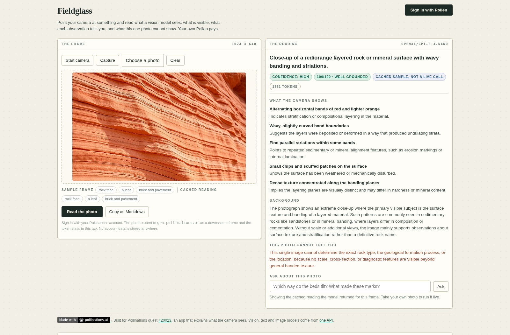

# Fieldglass

[](https://pollinations.ai/?ref=badge)

Point your camera at something and read what a vision model sees. One frame in, one
structured reading out: what is visible, what each observation tells you, the background
that makes sense of it, and what this single photo cannot tell you.

Live app: https://sugamdeol.github.io/fieldglass/



## What it does

You stand in front of something and want to know what it is, not a caption but an
explanation. Fieldglass sends one downscaled frame to a Pollinations vision model with a
system prompt that asks for a strict JSON reading, then shows only the parts of that reply
that hold together.

- **A frame, from the camera or your files.** `getUserMedia` with the rear camera where the
  browser allows it, a `Capture` button, or a photo from the device. The picture is drawn to
  a canvas capped at 1024 pixels on the long side (`frameSize`), so what leaves the browser is
  small and the model sees a sane resolution.
- **A reading, not a caption.** `core.js` normalises the reply into a subject line, a
  confidence, two to six observations with what each one implies, background, and one
  honest statement of what the photo cannot settle.
- **An integrity score.** The panel scores every reading out of 100 and lists what cost it
  points: an unknown confidence value, a thin background, a missing uncertainty statement,
  observations that only restate the subject, unclosed JSON, extra fields the page does not
  use. A reply with fewer than two usable observations is refused outright and the raw text
  is shown so you can see why. That number is the honest part of the app: a vision model
  sometimes describes what it expects to see, and you get to see that instead of a confident
  card over a thin reply.
- **Ask about the photo.** One more call puts your question to the same frame, with the
  earlier subject line as context, and keeps the answer with the reading.
- **Export.** Copy the whole reading plus your question as Markdown.

Try it on the three sample frames in `docs/examples/` (a rock face, a leaf, brick and
pavement) if you have nothing in front of you.

## Your own Pollen pays

Sign in with Pollinations (OAuth code flow with PKCE, public app key `pk_KrLm3z0waGtTf7FN`),
or paste your own `sk_` key with **Use this key**. The key lives in this tab's
`sessionStorage`, is sent to `gen.pollinations.ai` and nowhere else. There is no server of
ours and no shared key. One reading is one chat completion on `openai/gpt-5.4-nano` with the
frame attached and about 1.2k output tokens allowed, which is a fraction of a Pollen; a
follow-up question is a few hundred tokens.

## Run it

Open `index.html`. No build step, no dependencies, no bundler. `core.js` holds the reading
rules as pure functions, `app.js` the camera, the model calls and the drawing,
`index.html` the page.

Tests: `node --test core.test.js` (16 tests, no dependencies, Node 18+). They cover fenced
and prose-wrapped JSON, unclosed JSON, refusal on fewer than two observations, dropped
unusable observations, an invalid confidence value, a missing uncertainty statement, extra
fields, observations that restate the subject, clipping, the six-observation cap, frame
scaling, the Markdown export and the stop-word filter.

## The shape of the reply

```json
{
  "subject": "one sentence naming what this is",
  "confidence": "high",
  "reads": [{ "mark": "something visible in the photo", "means": "what that tells you" }],
  "context": "two or three sentences of background",
  "uncertain": "one thing this single photo cannot tell you"
}
```

`core.js` decides what is allowed on screen before anything is drawn: it takes the first
balanced JSON object out of the reply, clips every string, drops observations that carry no
observation, caps the list at six, refuses a reading with fewer than two, and notes every
repair it had to make.

## Cost and privacy

The frame is downscaled in the page before it is sent. Nothing is written to storage beyond
the session key, and there is no analytics script on the page.

## Quest

Built for [Pollinations quest #20023](https://github.com/pollinations/pollinations/issues/20023),
an app that explains what the camera sees, built on Pollinations models, with users paying
with their own Pollen.
